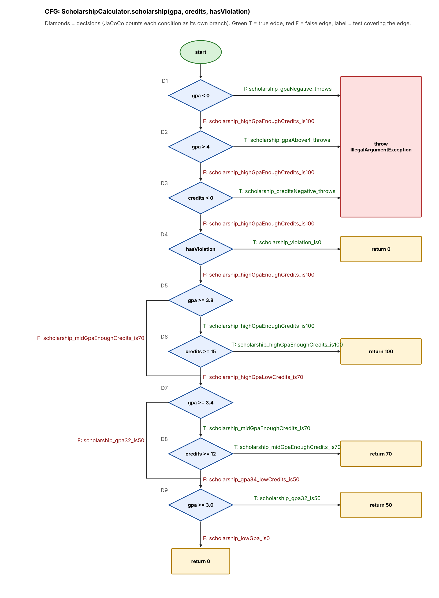

# Lab 9 - Code coverage with JaCoCo

**Name:** С. Одгэрэл
**Student code:** B232270099
**GitHub:** odgerel602

## Environment
```
openjdk version "17.0.21.0.2" 2026-10-22 LTS
OpenJDK Runtime Environment Microsoft-15779939 (build 17.0.21.0.2+1-LTS)
OpenJDK 64-Bit Server VM Microsoft-15779939 (build 17.0.21.0.2+1-LTS, mixed mode, sharing)

Apache Maven 3.9.16 (2bdd9fddda4b155ebf8000e807eb73fd829a51d5)
Maven home: C:\Users\Surface\Downloads\apache-maven-3.9.16-bin\apache-maven-3.9.16
Java version: 17.0.21.0.2, vendor: Microsoft, runtime: C:\Program Files\Microsoft\jdk-17.0.21.21-hotspot
Default locale: en_US, platform encoding: Cp1252
OS name: "windows 11", version: "10.0", arch: "amd64", family: "windows"
```

## Part A - Baseline
5 tests, all passing (results/mvn-verify-A.txt). Branch coverage 21/41, line coverage 15/25 (results/jacoco-A.csv).

**Тайлангийн ажиглалт (улаан мөр, шар ромбо):** Анхны JaCoCo тайланд 10 мөр улаан (хэзээ ч ажиллаагүй) байсан бөгөөд эдгээр нь `letterGrade`, `gpa`, `scholarship` дахь алдаа шидэх (`throw`) мөрүүд, C/D/F дүнгийн мөрүүд, `switch`-ийн C, D, `default` тохиолдол, мөн `scholarship`-ийн 50 ба 0 буцаадаг мөрүүд юм. Шар ромбо нь мөр ажилласан боловч нөхцөлийн зөвхөн нэг тал нь шалгагдсан гэсэн үг бөгөөд жишээ нь `if (hasViolation)` дээр зөвхөн false тал, `gpa >= 3.8 && credits >= 15` дээр зөвхөн true тал, `score < 0 || score > 100` дээр зөвхөн false тал шалгагдсан. Энэ 20 алдагдсан салбар (branch)-ыг B хэсэгт нэмэлт тестээр хамруулсан.

## Part B - Branch coverage to 100%


CFG-ийн ирмэг бүрийг хамардаг тестийн нэр (тест файлын метод нэртэй яг ижил):

| Шийдвэр | T ирмэг | F ирмэг |
|---|---|---|
| `gpa < 0` | scholarship_gpaNegative_throws | scholarship_highGpaEnoughCredits_is100 |
| `gpa > 4` | scholarship_gpaAbove4_throws | scholarship_highGpaEnoughCredits_is100 |
| `credits < 0` | scholarship_creditsNegative_throws | scholarship_highGpaEnoughCredits_is100 |
| `hasViolation` | scholarship_violation_is0 | scholarship_highGpaEnoughCredits_is100 |
| `gpa >= 3.8` | scholarship_highGpaEnoughCredits_is100 | scholarship_midGpaEnoughCredits_is70 |
| `credits >= 15` | scholarship_highGpaEnoughCredits_is100 | scholarship_highGpaLowCredits_is70 |
| `gpa >= 3.4` | scholarship_midGpaEnoughCredits_is70 | scholarship_gpa32_is50 |
| `credits >= 12` | scholarship_midGpaEnoughCredits_is70 | scholarship_gpa34_lowCredits_is50 |
| `gpa >= 3.0` | scholarship_gpa32_is50 | scholarship_lowGpa_is0 |

I added tests for every branch that Part A left uncovered: the three exception conditions in scholarship(), hasViolation, the && conditions in the 100 and 70 rules, the 50 and 0 outcomes, the letterGrade exceptions and the C/D/F grades, and the gpa() null/empty and F cases.
Result: 21 tests, 41/41 branches, 25/25 lines (results/mvn-verify-B.txt, results/jacoco-B.csv).

## Part C - Loop boundary tests
gpa() contains a loop, so I tested 0 iterations (empty array and null), 1 iteration (gpa_singleScore_isFour) and several iterations (gpa_manyScores_isTwoPointFive).
Result: 23 tests, all passing (results/mvn-verify-C.txt, results/jacoco-C.csv).

**Яагаад хэрэгтэй вэ:** Эдгээр тест хамралтыг нэмэгдүүлээгүй, учир нь B хэсэгт салбар, мөрийн хамрах хүрээ аль хэдийн 100% болсон байсан. Гэхдээ давталт 0, 1, олон удаа ажиллах үед л зөв үр дүн өгч байгааг батлах боломжтой бөгөөд хоосон массив, нэг элемент, off-by-one зэрэг алдаа зөвхөн энэ хязгаарын тохиолдлуудад гардаг.

## Part D - Boundary values and the bug
I added 7 boundary tests for letterGrade. letterGrade_60_isD failed with expected <D> but was <F> (30 tests, 1 failure, results/mvn-test-D-fail.txt).
Cause: the code used `score > 60` instead of `score >= 60`. I fixed it in its own commit (dcd1bd0).
Final result: 30 tests pass, 41/41 branches, 25/25 lines (results/mvn-verify-final.txt, results/jacoco-final.csv).

## Conclusion
Энэхүү лабораторийн ажлын B хэсэгт би салбар болон мөрийн хамрах хүрээг (branch and line coverage) 100%-д хүргэсэн хэдий ч кодод нэг алдаа (bug) үлдсэн байв. Тодруулбал, `score > 60` гэсэн мөрийг `score >= 60` гэж бичих ёстой байсан юм. Гэвч эдгээр хоёр хувилбар нь ижил салбаруудыг үүсгэдэг тул JaCoCo хэрэгсэл тэдгээрийг бүрэн хамрагдсан гэж тооцсон байна. Энэхүү алдаа нь D хэсэгт хязгаарын утгын сорилтуудыг (boundary tests) нэмэх үед л илэрсэн бөгөөд `score = 60` үед хийсэн сорилт амжилтгүй болсон юм. Энэ нь хамрах хүрээний хэмжүүр нь зөвхөн кодын аль хэсэг ажилласныг л харуулдаг болохоос, гарсан үр дүн зөв эсэхийг илэрхийлдэггүй болохыг харуулж байна. Ийм төрлийн бүтцийн сорилтуудыг хязгаарын утгын сорилтуудтай хослуулан хэрэглэж байж л кодон дахь бодит алдаануудыг илрүүлэх боломжтой.

## AI assistance
Энэхүү лабораторийн ажлын явцад би хиймэл оюун ухаанд суурилсан туслах (Claude)-ыг ашигласан. Энэ нь туршилтын тохиолдлуудыг (test cases) төлөвлөх, JUnit тестийн кодыг бичих, Git болон Maven командуудыг боловсруулах, мөн CFG-ийн бүдүүвч болон энэхүү README загварыг бэлтгэхэд тусалсан болно. Харин CFG-ийн бүдүүвчийг би өөрөө гараар зурж, бүх командыг өөрийн компьютер дээр ажиллуулж, үр дүнг `results/` хавтсанд үүссэн файлуудаас шалгасан.
